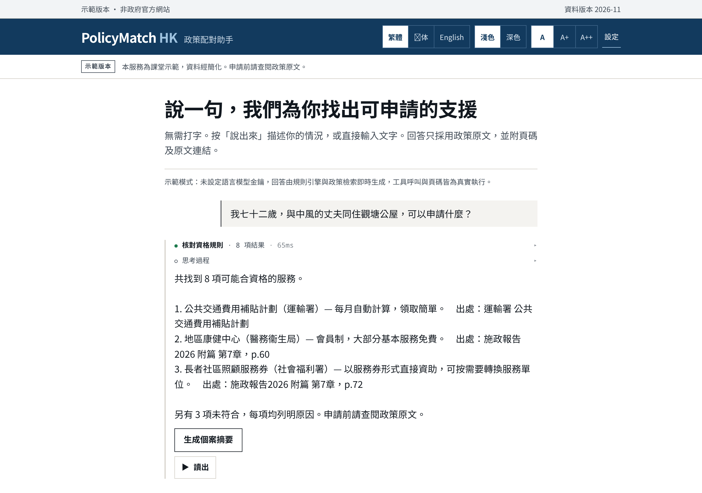
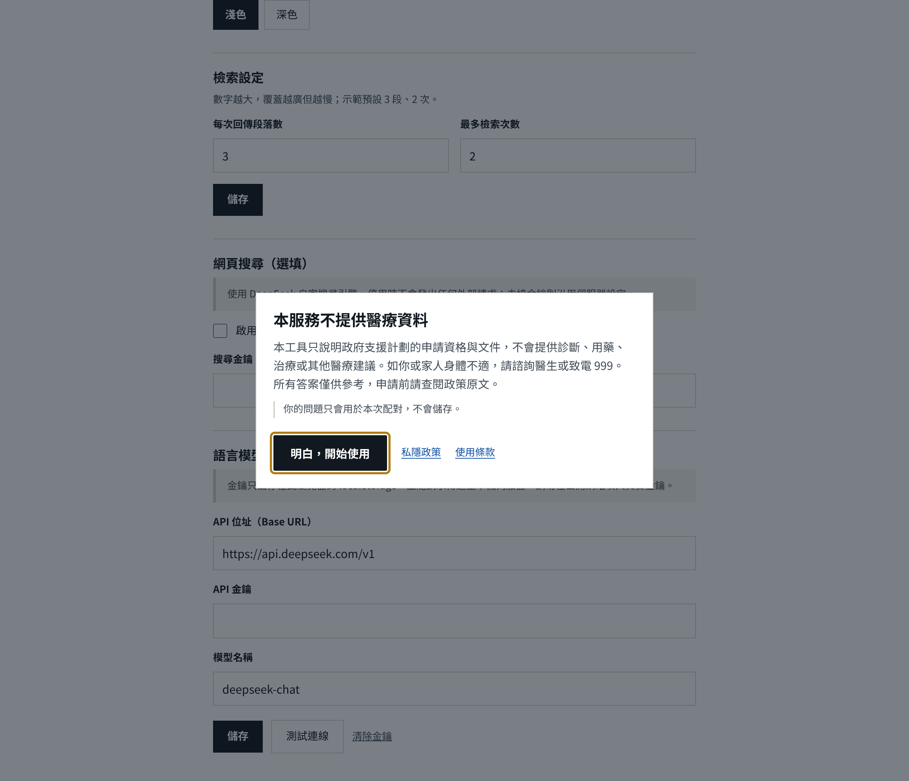

# PolicyMatch HK

An eligibility navigator for Hong Kong public services. You describe your situation in
your own words; the tool returns the schemes you can apply for, the documents each one
needs, and the page of the policy document that says so.

**Student prototype for VCP3202. Not a government website. Not legal, medical or financial advice.**



---

## Contents

- [What it does](#what-it-does)
- [Requirements](#requirements)
- [Quick start](#quick-start)
- [Run it with your own model key (optional)](#run-it-with-your-own-model-key-optional)
- [How the answer is produced](#how-the-answer-is-produced)
- [Project structure](#project-structure)
- [Data and citations](#data-and-citations)
- [Tests](#tests)
- [Troubleshooting](#troubleshooting)
- [Security and privacy](#security-and-privacy)
- [中文快速開始](#中文快速開始)
- [Licence](#licence)

---

## What it does

- **Understands plain language.** A carer can type "my husband had a stroke, we live in
  Kwun Tong public housing, what can we apply for?" No form, no dropdowns.
- **Matches on rules, not on vibes.** `matchSchemes` is a deterministic function. Eleven
  schemes are encoded as age, district, household, income and carer conditions. The
  language model never decides who qualifies.
- **Answers with a citation.** Every scheme line carries the department, the amount and a
  page number in the 2026 Policy Address Supplement. The page number links to `#page=NN`
  in the government PDF, so it opens at the right page.
- **Refuses when it should.** Medical questions go to a doctor or 999. Out-of-scope
  questions go to 1823. Attempts to override the instructions are treated as data, not
  commands. Nothing is guessed.
- **Speaks three languages.** Traditional Chinese, Simplified Chinese and English, with
  A / A+ / A++ text scaling, a light and dark theme, keyboard navigation and a skip link.

| Tool | What it returns |
| --- | --- |
| `matchSchemes` | Schemes the household qualifies for, plus the excluded ones with the failing condition |
| `searchPolicy` | Policy passages with page numbers and deep links |
| `getCurrentTime` | Today's date in Hong Kong time, so age answers are not guessed |
| `webSearch` | A live web answer for information outside the policy corpus (off unless a key is set) |
| `findElderlyCentres` | Neighbourhood elderly centres from public data |
| `getAeWaiting` | Accident and Emergency waiting times |
| `getWeatherStatus` | Current warning status |

Screens: home, chat, scheme detail, personal summary (printable to A4), settings,
accessibility statement, privacy policy, terms.

## Requirements

| Item | Version | Notes |
| --- | --- | --- |
| Node.js | 20.9 or newer (22 LTS recommended) | `node -v` |
| npm | 10 or newer | ships with Node |
| Disk | ~600 MB | `node_modules` is most of it |
| Network | first install and build | policy text and scheme rules are bundled offline |

No database, no login, no Docker. Optional: any OpenAI-compatible model endpoint if you
want the live-model mode described below.

## Quick start

The default build runs **without any API key**. Eligibility matching, policy retrieval,
citations and the refusal gate are all local. This is the mode to use for marking.

### macOS / Linux

```bash
git clone https://github.com/AJiTheHermes/policymatch-hk.git
cd policymatch-hk
npm install
npm run build
npm run start
```

### Windows (PowerShell or cmd)

```bat
git clone https://github.com/AJiTheHermes/policymatch-hk.git
cd policymatch-hk
npm install
npm run build
npm run start
```

Open <http://localhost:3008>.

Check the running mode:

```bash
curl http://localhost:3008/api/chat
# {"mode":"demo","acceptsBrowserKey":true}
```

`demo` means no key is configured anywhere — a deterministic agentic loop answers, but the
tool calls, the scores and the page numbers are real. `live` means a key was found (see
below).

### Development mode

```bash
npm run dev      # same port, hot reload
```

### Port already in use

```bash
npm run start -- -p 3010
```

## Run it with your own model key (optional)

Two ways in. Both use **your own** key; this repository ships with none.

### Option A — in the browser (no file editing)

1. Open <http://localhost:3008/settings>.
2. Fill in three fields:

   | Field | Example | Notes |
   | --- | --- | --- |
   | API base URL | `https://api.deepseek.com/v1` | Must be OpenAI-compatible and end with `/v1` |
   | API key | *your key* | Stored in this browser's `localStorage`, not in the repo |
   | Model name | `deepseek-chat` | Must exist on that endpoint |

3. Press the test button. The app calls `/api/llm-check`, which asks the endpoint for its
   model list **from the server**, so the browser never hits a CORS wall. The key is not
   echoed back.
4. Return to the chat and ask a question. `/api/chat` now reports `live`.



The key travels from your browser to the app's own server with each request (header
`x-llm-key`) and from there to the provider. It is never written to disk, never logged and
never committed. Clearing site data removes it.

### Option B — server environment (kiosk or demo laptop)

Create `.env.local` in the project root:

```dotenv
POLICYMATCH_LIVE=1
DEEPSEEK_API_KEY=your-key-here
```

Then rebuild and restart:

```bash
npm run build && npm run start
```

`.env.local` is in `.gitignore`. Do not commit it, and do not paste a key into an issue.

### Any other OpenAI-compatible provider

Option A already accepts any base URL, so no code change is needed for OpenAI, Moonshot,
Qwen, Groq, OpenRouter or a local `llama.cpp` server. Use that provider's OpenAI-compatible
base URL, its model name and its key — for example `http://127.0.0.1:8080/v1` with
`local-model`.

## How the answer is produced

Four layers, and the model is only the last one:

1. **Corpus.** The 2026 Policy Address Supplement and the department notes are split into
   passages. Each passage keeps its page number, taken from the PDF page header. Nothing is
   stored that cannot be traced back to a page.
2. **Retrieval.** Lexical scoring (BM25 over CJK bigrams) with a relevance grade. If the
   grade is weak the query is rewritten and retried **once** — never more than two attempts.
   Still weak: the answer is "not found".
3. **Tools.** Seven tools do the work a model cannot do reliably. Eligibility is code.
4. **Language.** The model receives the retrieved passage and the rule result, and writes
   one short sentence per line. It may not invent an amount; amounts come from the scheme
   table. In demo mode a template writes that sentence instead of a model, using the same
   tool output.

Guardrails run before the model is called: medical, out-of-scope and instruction-override
inputs get a fixed refusal instead of being forwarded. The check runs twice, once in the
browser and once in the route handler.

## Project structure

```text
app/
  page.tsx                chat screen
  api/chat/route.ts       streaming route; tools; guard; demo/live switch
  api/llm-check/route.ts  server-side key test (avoids CORS)
  api/tools/route.ts      executes tools in demo mode; returns the trace
  scheme/[id]/page.tsx    one scheme, with citation
  summary/page.tsx        printable case summary
  settings/page.tsx       language, theme, retrieval, model key
  accessibility, privacy, terms
components/               chat, disclaimer, mic button, speak button, site frame
lib/
  rules.ts                eligibility rules, pure functions
  schemes.ts              scheme table (11 schemes)
  tools.ts                matchSchemes, searchPolicy
  tools-server.ts         time, centres, A&E, weather, web search
  agentic.ts              retrieve -> grade -> rewrite -> answer
  guard.ts                classify() and refusal text
  rag-core.ts             BM25 over CJK bigrams
  policy.ts               schemes + 129 pages, merged retrieval, PDF deep links
  live.ts                 public-data fetchers, cached, best effort
  i18n.ts                 zh-Hant / zh-Hans / en strings
data/
  policy-pages.json       129 pages of policy text, page numbers preserved
  schemes.json            scheme rules and citation pages
tests/                    29 unit tests, e2e script, accessibility audit, screenshots
```

## Data and citations

| Item | Value |
| --- | --- |
| Policy pages bundled | 129 (124 with body text) |
| Schemes encoded | 11 |
| Citation granularity | page number plus a `#page=NN` deep link into the official PDF |
| Data version | 2026-11 |
| Live sources | public elderly-centre data, A&E waiting times, weather warnings |

The policy text is quoted from HKSAR Government publications for classroom demonstration.
Conditions are simplified; the department's application notes always win.

## Tests

```bash
npm test          # 29 unit tests: rules, retrieval, guard, agentic loop, live data
```

Last run on this repository: **29 passing, 0 failing** (Node 22).

Optional browser checks (need a Chromium binary and a server on port 3008):

```bash
node tests/e2e.mjs           # end-to-end conversation
node tests/a11y-audit.mjs    # accessibility pass
node tests/ui-shots.mjs      # screenshots, written to /config/answers/ui
```

## Troubleshooting

| Symptom | Cause | Fix |
| --- | --- | --- |
| `EADDRINUSE :3008` | another server is running | `npm run start -- -p 3010` |
| `/api/chat` still says `demo` | no key configured | use Option A or B above |
| `401` after entering a key | wrong key, or key belongs to another provider | re-enter; check the base URL matches the key |
| `404` from the test button | wrong base URL | it must be the OpenAI-compatible base ending in `/v1` |
| Model not found | model id typo | copy the exact id from the provider's model list |
| Slow first load | `npm run dev` compiles on demand | use `npm run build && npm run start` |
| Blank page after an upgrade | stale `.next` | `rm -rf .next && npm run build` |
| Node version error | older than 20.9 | install Node 22 LTS |

## Security and privacy

- **No key in this repository.** `.gitignore` excludes `.env`, `.env.local`, `.next`,
  `node_modules` and build output. The history contains no credentials.
- **Keys are per browser.** A key entered on the settings page lives in `localStorage` and
  is sent to the local server with each request. Nothing is persisted server-side.
- **Do not type a real key into a public deployment.** The settings page says so. If you
  host this on the internet, run it in demo mode, or set the key server-side and keep the
  settings page out of reach.
- **No accounts, no analytics, no trackers.** The only outbound calls are the provider
  endpoint you configure and the public data sources listed above.
- **Case summaries stay local.** A summary is written to `localStorage` only when the user
  presses the button, and can be deleted from the same page.

---

## 中文快速開始

```bash
git clone https://github.com/AJiTheHermes/policymatch-hk.git
cd policymatch-hk
npm install
npm run build
npm run start
```

開 <http://localhost:3008>。**預設唔需要 API key**：示範模式用規則引擎加政策檢索即時回應，工具呼叫、分數同頁碼都係真跑。

想接真模型（可選）：去 <http://localhost:3008/settings> 填你自己嘅 **API 位址**（例如 `https://api.deepseek.com/v1`）、**API 金鑰**、**模型名稱**（例如 `deepseek-chat`），按測試，再返對話頁問一句。金鑰只存喺你部瀏覽器嘅 localStorage，唔會寫入伺服器、唔會上載。

倉庫冇附任何金鑰。請勿把 `.env.local` 或金鑰提交上 GitHub。

---

## Licence

Code: MIT (see `LICENSE`). Policy text and scheme details: © HKSAR Government, quoted for
classroom demonstration; check the department's application notes before relying on any
figure. Not affiliated with, endorsed by, or operated by any government department.
